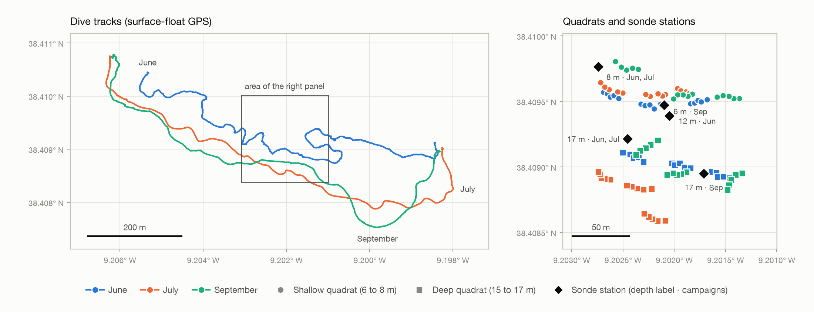

# KelpObserve Sesimbra 2026: dataset companion scripts

Companion repository of the dataset *KelpObserve Sesimbra 2026: diver quadrat surveys of the kelp* Saccorhiza polyschides *and water-column sonde profiles, Arrábida coast, Portugal* (version 1.0.0, Zenodo, [doi:10.5281/zenodo.23282075](https://doi.org/10.5281/zenodo.23282075)). It holds the scripts that derive the dataset's tidy tables from the files CCMAR delivered, pack the photographs, check the quadrat positions against bathymetry and draw the overview map, together with a summary of what the record contains. The transect and mapping videos are in a companion record, [doi:10.5281/zenodo.23350632](https://doi.org/10.5281/zenodo.23350632).

KelpObserve is an AQUASERV Transnational Access project (PID 42082) hosted by CCMAR (Centro de Ciências do Mar do Algarve, Universidade do Algarve, Faro, Portugal).

## The dataset

Field observations from three campaigns in 2026 (June, July and September) at one site with infralittoral rock habitat on the Arrábida coast of Portugal. The site is about 1.4 km east-south-east of the Cabo Espichel lighthouse (Sesimbra; 38.409° N, 9.202° W), inside the Professor Luiz Saldanha Marine Park. The observations were collected as reference data for mapping kelp habitat from satellite imagery.

- **Kelp quadrats.** 90 quadrats of 0.5 × 0.5 m along 18 transects in two depth strata. In each quadrat the divers recorded the cover of the annual kelp *Saccorhiza polyschides* and counted and measured its individuals (242 in all).
- **Sonde casts.** A multiparameter sonde (YSI EXO2) was lowered at the dive stations 7 times and logged 1,390 samples of temperature, salinity, dissolved oxygen, pH, fluorescence and turbidity.
- **Positions and tracks.** The recorded position of every quadrat, and one GPS track of the divers' surface float per campaign.
- **Quadrat photographs.** One photograph of each July quadrat (30 JPEG) and 33 frames of the September quadrats with their raw files (33 JPEG and 33 ARW). June has none.
- **Videos.** 20 transect and mapping videos, 77 minutes in all, in the companion record.

In each campaign three transects were laid in a shallow stratum (nominal depth 6 to 8 m) and three in a deep stratum (nominal depth 15 to 17 m), with five quadrats along each 20 m transect tape: 30 quadrats per campaign. Transects were laid anew in each campaign, so a quadrat number does not identify a fixed place. Cover was estimated by eye in the water; sizes are in cm, with a juvenile mark below 30 cm. No destructive sampling was made.

| | June | July | September |
|---|---|---|---|
| Quadrats surveyed | 30 | 30 | 30 |
| Quadrats with kelp recorded | 29 | 24 | 20 |
| Kelp individuals measured | 135 | 69 | 38 |
| Mean cover, shallow stratum (%) | 23.0 | 70.0 | 18.3 |
| Mean cover, deep stratum (%) | 19.1 | 26.0 | 3.6 |
| Sonde casts | 3 | 2 | 2 |

Mean cover counts a quadrat without kelp as 0 %; the one September quadrat without a cover value is left out.



## What the record contains

Tidy tables, the place to start:

| File | Rows | Content |
|---|---|---|
| `kelp_quadrats.csv` | 90 | One row per surveyed quadrat: position, dates, kelp cover and counts. |
| `kelp_quadrats.geojson` | 90 | The same rows as points, for GIS. |
| `kelp_individuals.csv` | 242 | One row per kelp individual: life stage and size. |
| `sonde_casts.csv` | 7 | One row per sonde cast: station, date, time and depth range. |
| `sonde_profiles.csv` | 1,390 | One row per sonde sample, all channels. |
| `dive_tracks.geojson` | 3 | One GPS track of the divers' surface float per campaign. |

Release copies of the five delivered files, with the scientific content unchanged:

| File | Content |
|---|---|
| `raw_ccmar_kelp_quadrats_2026.xlsx` | Kelp workbook: one row per kelp individual or empty quadrat, all three campaigns. |
| `raw_ccmar_sonde_casts_2026.xlsx` | Sonde workbook: every sample of the seven casts, as exported from the instrument. |
| `raw_ccmar_quadrat_positions_2026.gpkg` | Quadrat positions of all three campaigns (90 points). |
| `raw_ccmar_quadrat_positions_july_dive_log.gpkg` | July delivery of the positions, with the timed dive log: date, time and tape mark of each July quadrat. |
| `raw_ccmar_dive_tracks_2026.gpkg` | GPS tracks of the surface float, one per campaign. |

The photographs come in three ZIP archives (3.7 GB, stored without recompression) described file by file in `photographs.csv`. The documentation consists of the record's `README.md`, `data_dictionary.csv` (every column: type, unit, description, limits), `datapackage.json` (the same as a Frictionless Data Package), `raw_ccmar_manifest.csv`, `release_provenance.json`, the position check in `position_qc.csv` and `position_qc_provenance.json`, `overview_map.png`, `CITATION.cff`, `LICENSE.txt` and `checksums.sha256`.

### Before using the data

The record's README lists twenty known issues. The ones that matter most for reuse:

- **Survey dates differ between the delivered files.** `survey_date` gives the supported day for each quadrat (2 June; 7 July for shallow transects 1 and 2 and 8 July for the other July transects; 2 September) and `survey_date_evidence` states its basis. Use it for temporal matching.
- **Positions come from a towed surface float.** A recorded position can lie 10 m or more from the quadrat. Nine quadrats could not be reconciled with the lidar bathymetry at their recorded position; `position_check` holds the outcome.
- **Depth labels are nominal**, differ between the workbook and the position file, and are not measured depths of the quadrats.
- **September cover cells are blank** where June and July record 0. `cover_pct` holds 0 for all quadrats without kelp; `cover_pct_recorded` keeps the blank.
- **Sonde values are as delivered.** Calibration records were not supplied, turbidity and three computed channels contain negative values, and the clock's time zone is not stated.
- **One site, one summer.** The quadrats support comparisons between the three campaigns and the two strata at this site. They are not a habitat map.

## Scripts

The scripts form the Python package `arrabida_dataset`. Each one, run on the files of release 1.0.0, reproduces the corresponding file of the record byte for byte.

### Installation

```bash
python3 -m venv .venv
source .venv/bin/activate
pip install "arrabida-dataset[all] @ git+https://github.com/KelpObserve/arrabida-dataset"
```

The package needs Python 3.11 or later. The extras `map`, `photos` and `lidar` add matplotlib, Pillow and rasterio for the map, the photograph packing and the lidar sampling; `all` installs the three. To rebuild release 1.0.0 with the exact library versions used for it, clone the repository and install the pins first:

```bash
pip install -r requirements.txt
pip install --no-deps .
```

| Command | Module | Reads | Writes |
|---|---|---|---|
| `arrabida-tidy` | `make_tidy_tables` | the five delivered files | the six tidy tables |
| `arrabida-summary` | `summarize` | the tidy tables | the per-campaign summary table above, and the map on request |
| `arrabida-map` | `overview_map` | `kelp_quadrats.csv`, `sonde_casts.csv`, `dive_tracks.geojson` | `overview_map.png` |
| `arrabida-check-positions` | `check_positions` | `position_qc.csv`, `position_qc_provenance.json`, `kelp_quadrats.csv`, optionally the EMODnet lidar raster | a verdict on the archived position check, optionally a rebuilt table |
| `arrabida-pack-photos` | `pack_photographs` | the two delivered photograph folders | the three ZIP archives and `photographs.csv` |

Each command is also available as `python -m arrabida_dataset.<module>`.

### Tidy tables

Download the five delivered files from the Zenodo record into one folder, keeping their names, then:

```bash
arrabida-tidy --raw-dir raw --out-dir tidy
```

- Groups the rows of the kelp workbook into quadrats by date, depth, transect and quadrat number. Each measured individual becomes one row of `kelp_individuals.csv`; the per-quadrat cover, erosion and epibiont values go to `kelp_quadrats.csv`.
- Joins each quadrat to the position with the same campaign, stratum, transect and quadrat number. The two files label the strata with different depths, so the join key is the stratum.
- Adds the date, time and tape mark of each July quadrat from the timed dive log.
- Swaps the sonde dates back from their day-first storage and marks the profile leg of each cast: the samples between its shallowest and deepest reading.
- Rounds the dive-track coordinates to seven decimals and drops their Z values.
- Adds `survey_date` and `survey_date_evidence` from the campaign chronology, which is encoded explicitly in the function `survey_date()`, and retains the source date fields.

Nothing is modelled, interpolated, offset, filtered or binned, and no observation is removed. The record's `checksums.sha256` lists the SHA-256 of each tidy file and its `release_provenance.json` records the SHA-256 of `make_tidy_tables.py` as used, so a rebuilt set can be checked with `shasum -a 256` (`sha256sum` on Linux).

### Summary table and map

```bash
arrabida-summary --tidy-dir tidy --map overview_map.png
```

prints the summary table and draws the map shown above: dive tracks on the left, quadrats by campaign (colour) and stratum (shape) with the sonde stations on the right. The map is drawn from the tidy files alone and carries no third-party imagery. `arrabida-map` draws it on its own.

### Position check

```bash
arrabida-check-positions --record record
arrabida-check-positions --record record --lidar emodnet_hr_lidar_sesimbra.tif --out position_qc_rebuilt.csv
```

The first form recomputes every residual and status of the archived `position_qc.csv` from the lidar samples and modelled water levels stored in `position_qc_provenance.json` and reports whether they agree (81 consistent, 5 depth mismatches, 4 without bathymetry in release 1.0.0). The second form also samples the EMODnet lidar raster at the quadrat positions (containing cell, and the finite range of the surrounding 3 × 3 cells), rebuilds the table and compares it with the archived one. The raster is not part of the record: it is the `590_HR_Lidar_Sul` model of EMODnet Bathymetry, clipped to the site, depths positive downwards relative to LAT. The check tests agreement with the nominal depth labels, not the accuracy of the positions.

### Photographs

```bash
arrabida-pack-photos --july <July folder> --september <September folder> --out record --tidy-dir record
```

reads the two photograph folders as CCMAR delivered them, names each file by quadrat (July) or by capture order within its transect (September), reads camera, lens and capture time from the EXIF of each JPEG and ARW, writes the three archives without recompression and `photographs.csv`, and runs the checks of the record. `photo_sources.csv`, shipped with the package, pins the size and SHA-256 of every delivered file, so a rerun confirms it packed the same ones.

### Tests

```bash
pip install -e ".[all,dev]"
ruff check .
pytest
```

The unit tests need no data. The tests in `tests/test_record.py` compare the output of the scripts with the files of the record; `tests/conftest.py` sets where those files come from. Changes are listed in `CHANGELOG.md`.

## Licence and citation

The code is released under the Apache License 2.0 (see `LICENSE`). The data are licensed CC BY 4.0 under the Zenodo record.

Cite the data as:

> Rusu, A., Botezat, O., Paulo, D., Encarnação, J., Rosado, G. (2026). KelpObserve Sesimbra 2026: diver quadrat surveys of the kelp Saccorhiza polyschides and water-column sonde profiles, Arrábida coast, Portugal (Version 1.0.0) [Data set]. Zenodo. https://doi.org/10.5281/zenodo.23282075

`CITATION.cff` gives the citation for the software.

## Credits

The field surveys were performed by the CCMAR Scientific Dive Centre (Diogo Paulo, João Encarnação, Guilherme Rosado).

## Funding

The project leading to these results has received funding from the European Union's Horizon Europe research and innovation programme under grant agreement No 101131121 (AQUASERV), through Transnational Access project PID 42082 (KelpObserve) hosted by CCMAR. This output reflects only the authors' view and the European Union cannot be held responsible for any use that may be made of the information contained therein.

AQUASERV Transnational Access supported access to the coastal study site and field services provided by CCMAR, together with travel and accommodation for Pineview staff. Subsequent KelpObserve data processing and analysis, software development, and preparation of the research outputs were carried out by Pineview through its own in-kind contribution.
